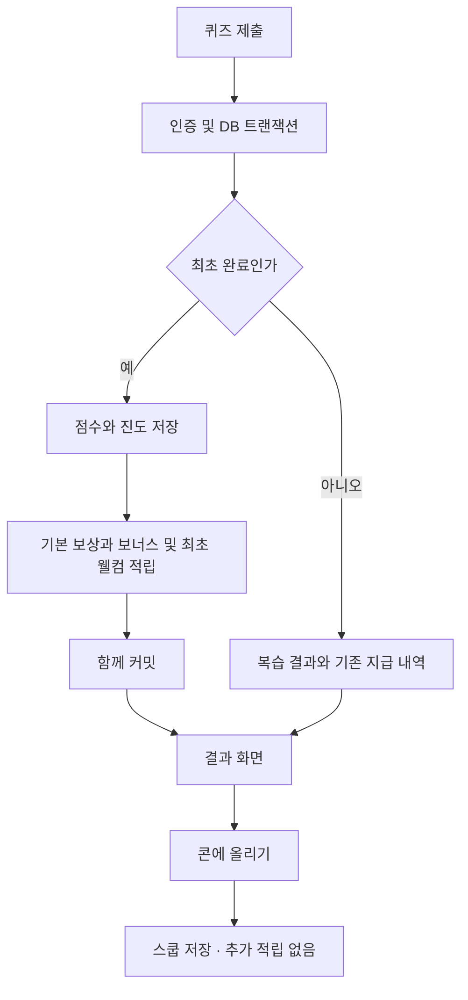

# 크레딧 정책 도입 계획

작성일: 2026-10-24 KST

상태: P0·P1·P2 완료. P3 상점 스키마와 화면을 판매 비활성 상태로 준비 중이다. 앱 스토어 배포는 별도다. 상품 4종의 가격은 2026-10-26 확정했다.

범위: 정책 → DB 스키마·권한 → 서버 트랜잭션·API → 화면 → 데이터 전환·검증·출시.

## 1. 목표와 기준

아티클을 처음 끝까지 학습하면 크레딧이 쌓이고, 모은 크레딧으로 내 콘을 꾸민다. [확장.md](./확장.md) §2의 **학습 보상·꾸미기 전용 재화** 방향을 구체화한다.

현재 무료 열람 1회·추가 열람 최대 3회는 별도로 유지한다. 크레딧으로 열람 횟수를 구매하지 않으며, 광고 시청만으로 크레딧을 지급하지 않는다. 현금 충전·환전·양도·유료 구독은 이번 계획의 범위 밖이다.

출시는 세 단계로 나눈다.

1. **적립:** 최초 학습 보상, 웰컴 보상, 잔액·내역·결과 표시.
2. **사용:** 꾸미기 미리보기, 아이템 구매·소유·적용, 복구.
3. **확장:** 실제 적립·사용 데이터를 확인한 뒤 스트릭 보상과 아이템 확대.

2026-10-24 P0에서 관련 운영 DB 스키마·함수·권한을 읽기 전용으로 대조하고 `정책.md` §18에 구현 기준을 반영했다. 결과와 발견 사항은 [P0 점검 기록](./크레딧-P0-점검.md)을 따른다. 스키마·애플리케이션 코드는 아직 변경하지 않았다.

## 2. 현재 구조와 수정이 필요한 지점

| 영역 | 현재 확인한 동작 | 계획에 반영할 사항 |
|---|---|---|
| 로그인 | `lib/api.ts`의 `getRequestContext()`가 Bearer 토큰을 검증하고 익명 계정을 제외 | 로그인한 계정에만 적립·사용. 게스트 지갑이나 계정 병합을 새로 만들지 않음 |
| 열람 | `open_article_reader` → `open_article_with_quota`가 최초 열람과 쿼터 차감을 원자 처리 | 크레딧 적립 조건으로 기존 열람 기록을 요구 |
| 진행 | `(user_id, article_id)`가 유일 키. `started → completed → saved` | 보상 단위도 **기사 ID**. 난이도별 `variant_id`를 보상 키로 사용하지 않음 |
| 최초 채점 | 외부 글은 수준 upsert와 진행 upsert가 별도 요청. Original은 조건부 진행 UPDATE | 두 경로 모두 최초 완료 판정·기록·보상을 하나의 RPC로 통합 |
| 복습 | 최초 점수·수준·스쿱을 유지하며, Original은 반복 풀이 지원 | 복습에는 추가 보상 없음 |
| 스쿱 | `/api/progress/save`에서 저장해야 콘에 추가 | 완료 보상과 스쿱 저장을 구분. 저장하지 않고 나가도 지급된 크레딧 유지 |
| 결과 재진입 | `GET /api/quiz`가 저장된 결과를 다시 조립 | 최초 POST뿐 아니라 GET 결과에도 지급 내역 제공 |
| 내 콘·계정 | `/cone`, `/account`와 하단 탭이 이미 존재 | 기존 화면을 확장. 과거 기획의 `/me`·계정 화면 신설 작업은 제외 |
| 색상 | `scoopShade(domainKey, dateStr, articleId)` 순수 함수 | 기사 ID 인자를 유지하고 꾸미기 식별자만 추가 |
| 프로필 권한 | `profiles`에 본인 UPDATE 정책 존재 | 유료 아이템 적용 상태는 별도 서버 전용 쓰기 테이블에 저장 |
| 보관·탈퇴 | 이용량 로그는 30일 정리, 학습 기록은 탈퇴까지 보관 | 크레딧 원장을 이용량 정리 대상에 넣지 않음. 계정 삭제 시 함께 삭제 |
| 빌드 | `route.api.ts`는 Vercel API, Capacitor는 정적 내보내기 | API·클라이언트 분리를 유지하고 두 빌드 검증 |

`확장.md`의 예제는 구현에 그대로 복사하지 않는다. 게스트 지원, UTC 자정, `user_id,variant_id` 충돌 키, 기존 색 함수 인자 수 등의 설명이 현재 코드와 다르다. 날짜는 [정책.md](./정책.md)와 같이 **Asia/Seoul**을 사용한다.

## 3. 정책 v1 구현 기준

### 3.1 적립 규칙

| 사유 | 지급량 | 발생 조건 | 중복 방지 기준 |
|---|---:|---|---|
| `article_read` | +10 | 공개 가능한 글의 전체 퀴즈를 처음 제출해 `started → completed` 전환 성공 | 사용자 + 기사 + 사유 |
| `quiz_bonus` | +0~10 | 같은 최초 제출의 `round(정답 수 / 문항 수 × 10)` | 사용자 + 기사 + 사유 |
| `welcome` | +100 | 크레딧 도입 이후 그 계정의 첫 보상 대상 학습 완료 | 사용자 + 고정 출처 `account` |

4문항 기준 정답 수 0·1·2·3·4개의 보너스는 각각 **0·3·5·8·10**이다. 따라서 기사 한 편의 합계는 10·13·15·18·20이다. 0점이라도 모든 문항을 제출해 학습을 마치면 기본 보상 10을 받는다.

- 외부 아티클과 Original 기초에 같은 보상 규칙을 적용한다. Original은 기존대로 수준을 변경하지 않는다.
- 처음 완료한 **기사당 평생 1회**다. 난이도를 바꾸거나, 퀴즈를 다시 풀거나, 콘에 다시 저장해도 늘지 않는다.
- 보너스는 최초 제출 점수로 확정한다. 이후 더 높은 점수를 받아도 차액을 지급하지 않는다.
- 웰컴 보상은 가입·로그인·페이지 조회가 아니라 첫 보상 대상 완료와 함께 지급한다. 기존 회원도 같은 조건으로 1회 받는다. P0에서 이 값을 구현 기준으로 채택했다.
- 열람만 하거나, 미응답이 있거나, 서버 채점이 실패한 경우 적립하지 않는다. 클라이언트의 점수·보상액·사용자 ID를 신뢰하지 않는다.
- v1은 별도 일일 적립 상한을 두지 않는다. 과거에 열어 둔 글을 오늘 여러 개 완료할 수 있으므로 **하루 열람 상한 4편을 하루 완료·보상 상한으로 간주하면 안 된다.** 일일 80은 강제 한도가 아니다.
- 만료·월별 초기화·최대 보유량 제한은 v1에 두지 않는다. 콘의 월 변경과 크레딧 잔액은 독립이다.
- 과거 완료분은 자동 소급 지급하지 않는다. 도입 전 `started` 상태인 글을 도입 후 처음 완료하면 정상 지급한다.
- 콘텐츠가 나중에 비공개로 전환되어도 이미 지급한 정상 보상은 유지한다. 새 채점은 기존 공개 권리 검사를 통과해야 한다.

### 3.2 사용 규칙과 상품 가격

| P3 상품 | 가격 | 적용 범위 |
|---|---:|---|
| 설탕 별 토핑 | 150 | 체리 대신 별 토핑 |
| 베리빛 스쿱 | 130 | 스쿱 색상 |
| 코코아 콘 | 140 | 콘 색상 |
| 밤하늘 배경 | 120 | 내 콘 영역 배경 |

- P3 가격은 2026-10-26 사용자 확인으로 확정했다. 운영 `cosmetic_items`의 가격도 이 값이며 `catalog_version=1`이다. 최초 판매 전 변경할 경우에도 상품별 버전을 올려 재확인을 받는다.
- 웰컴 100을 포함하면 매일 3/4 정답으로 한 편씩 완료할 때 3일째 154가 된다. 첫 아이템 3일 도달은 이 조건에서의 예시이며 모든 사용자에게 보장되는 값은 아니다.
- 아이템은 계정별 영구 소유다. 같은 상품을 두 번 구매하지 않는다. 소유 후 적용·해제는 무료다.
- 판매 중지와 소유권 회수는 별개다. 판매가 끝나도 기존 소유자는 계속 사용할 수 있다.
- 사용자가 확정한 구매의 단순 취소·재판매는 v2에 넣지 않는다. 장애로 인한 잘못된 차감은 원본 거래를 참조하는 보정 원장으로 복구한다.
- 배경·팔레트 적용은 우선 **내 콘 영역**으로 제한한다. 리더·주문서 전체 테마 변경은 별도 검증 후 확장한다.

### 3.3 P0에서 채택한 구현 기준

| 항목 | 구현 기준 | 값 변경 시 영향 |
|---|---|---|
| 표시 이름 | 크레딧 | 화면 문구만 변경. 내부 명칭 `credits` 유지 |
| 보너스 | 점수 비례 0~10 | 원장 정책 버전·채점 테스트 변경 |
| 웰컴 | 첫 보상 대상 완료 시 100, 기존 회원 포함 | 지급 시점·대상 테스트 변경 |
| 과거 완료 보상 | 소급 없음 | 소급을 선택하면 별도 검증 가능한 배치 필요 |
| 보관 | 무기한, 탈퇴 시 삭제 | 만료를 넣으면 만료 원장·차감 순서 추가 설계 필요 |
| 꾸미기 범위 | 내 콘만 | 전체 앱이면 대비·범례·리더까지 검증 범위 확대 |
| 스트릭 | v1/v2 제외, v3 후보 | 날짜 집계·중복 방지·지급 시점 추가 |

## 4. 스키마 변경

아래는 논리 설계다. 실제 SQL 파일은 구현 단계에서 Supabase CLI가 생성한 마이그레이션에 작성한다. 기존 마이그레이션은 수정하지 않는다.

### 4.1 1차: `credit_policy` — 서버가 읽는 정책 설정

단일 행 테이블로 다음 값을 관리한다. 브라우저는 필요한 값만 API 응답으로 받는다.

| 컬럼 | 타입·제약 | 용도 |
|---|---|---|
| `id` | smallint PK, `CHECK (id = 1)` | 단일 설정 |
| `version` | integer, 양수 | 현재 정책 버전 |
| `starts_at` | timestamptz nullable | 최초 적립 개시 시각. 최초 활성화 이후 고정 |
| `earning_mode` | text, `inactive / active / paused` | 도입 전·운영·일시 중지 구분 |
| `spending_enabled` | boolean, 기본 false | 상점 사용 제어 |
| `write_contract_required` | boolean, 기본 false | 이전 서버의 직접 진도·수준 쓰기 차단 전환. true 이후 해제하지 않음 |
| `article_reward` | integer, 기본 10, 0 이상 | 기본 보상 |
| `quiz_bonus_max` | integer, 기본 10, 0 이상 | 점수 보너스 상한 |
| `welcome_reward` | integer, 기본 100, 0 이상 | 최초 보상 |
| `updated_at` | timestamptz | 설정 변경 시각 |

정책의 실행 기준값은 DB에 한 번만 둔다. TypeScript는 API로 받은 값을 표시하고, 같은 숫자를 별도 하드코딩하지 않는다. 정책 변경 시 `version`을 올리며 이전 원장의 금액·버전을 수정하지 않는다. 활성화 시각은 DB 시각으로 기록한다. `inactive`는 starts_at=null, `active/paused`는 starts_at이 있어야 하며 active 전에 쓰기 계약 보호를 켜야 한다. 최초 활성화 후 inactive 복귀·starts_at 변경은 금지한다.

### 4.2 1차: `credit_events` — 잔액의 유일한 근거

| 컬럼 | 타입·제약 | 용도 |
|---|---|---|
| `id` | bigint identity PK | 거래 식별자, API에서는 문자열로 직렬화 |
| `user_id` | uuid NOT NULL, FK `profiles(id) ON DELETE CASCADE` | 소유 계정 |
| `amount` | integer NOT NULL | 적립 양수, 구매 음수, 보너스 0 허용 |
| `reason` | text NOT NULL, CHECK 허용 목록 | `article_read / quiz_bonus / welcome / purchase / adjustment` |
| `source_id` | text NOT NULL, 빈 문자열 금지 | `article:<id>`, `account`, `item:<id>`, `correction:<id>` |
| `policy_version` | integer NOT NULL | 지급·차감 당시 정책 버전 |
| `related_event_id` | bigint nullable, FK `credit_events(id)` | 운영 보정이 참조하는 원본 거래 |
| `metadata` | jsonb NOT NULL, 기본 `{}` | 지급을 일으킨 article ID·최초 variant ID·정답 수·총 문항 수, 구매 가격·상품 버전 등 제한된 스냅샷 |
| `created_at` | timestamptz NOT NULL, DB 기본값 | 실제 거래 시각 |

제약·인덱스:

- `UNIQUE (user_id, reason, source_id)`. 정책 버전은 유일 키에 넣지 않는다. 정책을 올려도 같은 기사·웰컴을 재지급할 수 없게 한다.
- 기본 보상·웰컴은 양수, `quiz_bonus`는 0 이상, `purchase`는 음수, `adjustment`는 0이 아닌 값으로 제한한다. 설정에서 기본 보상을 0으로 끄는 경우에는 해당 이벤트를 만들지 않는 것으로 정의한다.
- `(user_id, created_at DESC, id DESC)` 인덱스로 계정별 내역 커서 페이지 조회와 잔액 합계를 지원한다. `related_event_id`에도 인덱스를 둔다.
- 잔액은 `COALESCE(SUM(amount), 0)`으로 계산한다. `profiles.balance`나 별도 지갑 캐시를 함께 쓰지 않는다. 합계는 bigint로 계산하고 API의 안전한 정수 범위를 확인한다.
- 정상 경로는 INSERT만 한다. 과거 거래 UPDATE/DELETE로 잔액을 수정하지 않는다. 계정 탈퇴에 따른 전체 삭제는 예외다.
- 원장에 원문·정답·이메일을 복제하지 않는다. 내역의 기사 제목은 공개 가능한 현재 데이터에서 가져오고, 비공개면 `학습 완료 보상`으로 표시한다.
- 보정 RPC는 참조 거래도 같은 사용자 소유인지 확인한다. `source_id`와 필요 시 원본 구매별 유일 보정 제약으로 중복 복구를 막는다.

`quiz_bonus = 0`도 최초 보너스가 확정되었다는 기록으로 남긴다. UI에서는 기사별 기본·보너스를 묶어 한 줄로 표시할 수 있다.

웰컴 이벤트에도 지급을 일으킨 기사 ID를 기록한다. 결과 재조회에서는 그 기사에 연결된 웰컴만 표시하며, 다른 기사 결과에 웰컴 100을 반복해서 합산하지 않는다.

### 4.3 2차: 상점·소유·적용

| 테이블 | 주요 컬럼 | 제약·동작 |
|---|---|---|
| `cosmetic_items` | `id text PK`, `slot`, `name_ko`, `price integer`, `asset_key`, `catalog_version integer`, `is_active`, `sort_order` | slot은 `palette / cone / topping / background`, 가격은 양수. 가격·판매 여부는 서버 조회값이 기준 |
| `user_unlocks` | `user_id`, `item_id`, `purchase_event_id`, `acquired_at` | PK `(user_id, item_id)`, 계정 FK CASCADE, 상품 FK, 원장 FK·유일 구매 거래 |
| `user_cosmetics` | `user_id`, `slot`, `item_id`, `updated_at` | PK `(user_id, slot)`, `(user_id, item_id)`가 `user_unlocks`를 참조. 서버만 쓰기 |

- `user_unlocks.item_id`와 외래 키 조회에 필요한 인덱스를 추가한다. `user_cosmetics(user_id, item_id)` 인덱스도 추가한다.
- 적용 행이 없으면 기본 팔레트·와플 콘·기본 체리·기본 배경을 사용한다. 기본 외형을 가짜 구매 거래로 만들지 않는다.
- 기본으로 되돌리기는 해당 슬롯의 적용 행을 삭제하는 동작이다. 소유권은 그대로 유지한다.
- `slot`과 상품 유형의 일치는 적용 RPC에서 검증한다. 필요 시 복합 FK로도 강제한다.
- `profiles.theme_id` 같은 컬럼은 추가하지 않는다. 현재 프로필 수정 권한으로 구매 검사를 우회할 수 있는 구조를 피하기 위해 별도 테이블을 사용한다.
- DB에는 색상 값·SVG 본문 대신 `asset_key`를 저장한다. 실제 렌더러는 `lib/cosmetics.ts` 등의 코드 레지스트리가 관리한다. 등록된 모든 상품의 에셋 존재를 출시 검사한다.
- 이미 판매한 상품 ID는 재사용·삭제하지 않는다. 숨겨진 상품도 기존 소유권과 적용을 복원할 수 있어야 한다.

### 4.4 RLS·GRANT·RPC 실행 권한

- 신규 public 테이블은 모두 RLS를 활성화한다. `credit_policy`는 일반 사용자에게 직접 조회·수정 권한을 주지 않는다.
- `credit_events`, `user_unlocks`, `user_cosmetics`는 본인 행 SELECT만 허용한다. `USING (user_id = (select auth.uid()))`에 비익명 조건도 반영한다. `anon`은 접근하지 못한다.
- `authenticated`의 INSERT/UPDATE/DELETE 및 시퀀스 쓰기 권한을 명시적으로 제거한다. 테이블 접근 GRANT와 RLS를 각각 검사한다. 상품 목록은 인증 API에서 제공한다.
- 새 RPC는 기존 쿼터 RPC처럼 `SECURITY INVOKER`, `SET search_path = ''`, 스키마를 명시한 참조를 사용한다.
- 함수 생성과 함께 `PUBLIC`, `anon`, `authenticated`의 EXECUTE를 회수하고 `service_role`에만 부여한다. 인증된 서버가 검증한 `user.id`만 전달한다.
- 서버 키를 브라우저 번들에 넣지 않는다. 관리자 보정 기능도 일반 사용자 API에 노출하지 않는다.

RLS와 테이블 GRANT는 별도 접근 제어다. 새 테이블의 자동 노출 여부를 가정하지 않고 필요한 권한을 명시한다. [Supabase RLS 공식 문서](https://supabase.com/docs/guides/database/postgres/row-level-security)

## 5. 적립 트랜잭션과 서버 흐름

### 5.1 `grade_quiz_with_credits` RPC

`POST /api/quiz/grade`는 인증·입력 형식 검사 후 `grade_quiz_with_credits(user_id, variant_id, answers)`를 호출한다. 클라이언트 점수나 보상액을 인자로 받지 않는다. 보상만 기존 라우트 마지막에 추가하면 진도 저장 성공·적립 실패를 복구하기 어려우므로, 채점의 영속화 경로 자체를 원자화한다.

1. `profiles`의 해당 사용자 행을 `FOR UPDATE`로 잠근다. 삭제되었거나 익명 계정이면 종료한다. 이어 정책 행을 `FOR SHARE`로 읽어 활성화·중지 전환과 직렬화하고 새 RPC의 내부 쓰기 계약 버전을 설정한다.
2. variant → article → 권리 행을 기존 reader RPC와 일관된 순서로 확인·잠근다. 현재 공개 여부를 재검사한다. 퀴즈 문항도 일정한 ID 순서로 읽고 잠근다.
3. 기존 `user_article_progress`를 확인한다. 없으면 `article_not_opened`; 임의 제출로 열람 쿼터를 우회할 수 없다.
4. 답안의 키·보기 인덱스·전체 문항 응답을 검증하고 DB의 정답으로 채점한다. v1은 기존 4문항 규칙을 유지한다.
5. 이미 `completed` 또는 `saved`면 복습 결과와 기존 크레딧 지급 내역을 반환한다. 진행·수준·원장은 쓰지 않는다.
6. 최초 완료이면 DB 시각으로 정책 적용 여부를 판단한다. `inactive` 또는 개시 전이면 기존 학습만 처리하고, `active`면 보상 대상이다. `paused`이면 최초 완료 변경 전 `credits_temporarily_unavailable`로 종료한다.
7. 외부 글만 현재 수준 행을 잠그고 최근 점수·수준을 갱신한다. Original은 이 단계를 건너뛴다.
8. 최초 점수·답안·완료 variant·완료 시각을 저장하고 `started → completed`로 변경한다.
9. 보상 대상이면 기본·보너스 이벤트를 생성하고 웰컴이 없는 계정에 웰컴을 추가한다. 원장에 당시 정책 버전과 실제 금액을 저장한다.
10. 지급 내역·현재 잔액·학습 결과를 반환한다. 어느 단계든 실패하면 수준·진도·원장 모두 롤백한다.

최초 완료 여부는 잠금 이후 DB에서 결정한다. React의 제출 잠금이나 사전 SELECT만으로 판정하지 않는다. 기본·보너스 삽입의 예상치 못한 유일 키 충돌은 무조건 무시하지 말고 기존 진행·원장의 정합성을 확인한다.

수준 계산을 DB로 옮길 때 `lib/level.ts`의 최근 3회 평균, 0.75/0.4 경계, 1~3 클램프와 일치하는 입력·출력 테스트를 만든다. 온보딩 저장은 같은 사용자 잠금의 `save_onboarding_preferences` RPC로 옮긴다. 기존 분야의 수준·점수 이력은 보존하고 신규 분야만 초기화한다. 새 경로 배포 후 브라우저의 수준 직접 쓰기 권한을 회수한다. 동시 생성·재저장 및 구버전 앱 전환은 [P0 기록 §3](./크레딧-P0-점검.md)을 따른다.

### 5.2 재시도·복습·저장의 분리

- 응답을 잃어 같은 요청을 다시 보내도 같은 기사의 지급 기록을 반환하고 추가 적립하지 않는다.
- 결과를 다시 여는 `GET /api/quiz`에도 같은 보상 내역이 보인다. GET에서는 적립하지 않는다.
- 최초 저장 결과를 표시할 때는 `progress.variant_id`에 해당하는 원래 문항·답안을 사용한다. 다른 난이도의 문항에 최초 답안을 대입하지 않는다.
- `POST /api/progress/save`도 같은 사용자 잠금과 조건부 전환을 따르게 한다. 이미 saved인 행의 `saved_at`을 다시 쓰지 않는다. 채점·저장 동시 요청이 saved 상태를 completed로 되돌려서는 안 된다.
- 현재 제출의 `score`와 보상의 기준인 최초 점수가 다를 수 있다. 복습 응답은 현재 연습 결과와 최초 지급 내역을 명확히 나눈다.

같은 사용자의 적립·구매·적용·보정은 동일한 `profiles` 행 잠금을 사용한다. 이로써 잔액을 읽고 쓰는 순서가 직렬화된다. 트랜잭션 안에서는 외부 HTTP·LLM 호출을 하지 않는다. [PostgreSQL 행 잠금 문서](https://www.postgresql.org/docs/current/explicit-locking.html#LOCKING-ROWS)

## 6. 구매·적용 트랜잭션

### 6.1 `spend_credits` RPC

입력은 검증된 사용자 ID, 상품 ID, 화면에서 본 `catalogVersion`이다. **차감 금액은 DB 상품 가격에서 읽는다.** 기대 버전은 변경 감지용이며 가격 결정 권한이 아니다.

1. 사용자 행을 잠그고 계정 유효성을 확인한다.
2. 해당 상품을 이미 소유하면 `already_owned`와 현재 잔액을 반환한다. 과거 구매 응답 유실도 이 경로로 복구한다. 판매 중지·가격 변경·구매 일시 중지보다 이 확인을 먼저 한다.
3. 구매 가능 상태와 상품의 활성 상태를 검사하고 상품 행을 잠근다.
4. 카탈로그 버전이 바뀌었으면 `price_changed`와 새 가격·버전을 반환한다. 자동으로 새 가격을 결제하지 않는다.
5. 원장 합계와 가격을 비교한다. 부족하면 `insufficient_credits`와 부족액을 반환하며 아무것도 쓰지 않는다.
6. `purchase` 음수 원장과 `user_unlocks`를 같은 트랜잭션에 INSERT한다.
7. 커밋 후 구매 결과·새 잔액·보유 목록을 반환한다. 적용은 별도 동작이다.

같은 상품의 재요청은 사용자+상품 유일 키로 멱등 처리한다. 다른 상품의 동시 구매도 같은 잠금을 사용하므로 합계가 음수가 될 수 없다. 원장 합계가 음수가 아님은 행별 CHECK만으로 보장되지 않으므로, **모든 차감 경로가 이 트랜잭션 규약을 지켜야 한다.**

### 6.2 `equip_cosmetic` RPC

- 사용자·슬롯·상품 소유권·슬롯 일치를 검사한 뒤 `user_cosmetics`를 갱신한다.
- `itemId: null`은 해당 슬롯의 기본 외형으로 되돌리기다.
- 구매 전 미리보기는 UI 임시 상태이고 DB에 저장하지 않는다.
- 구매에 성공하고 적용에 실패해도 아이템은 보유 상태로 남는다. 적용 재시도에는 차감하지 않는다.
- 판매 중지된 상품도 이미 소유했다면 적용할 수 있다. 안전한 렌더링이 불가능한 에셋은 기본 외형으로 대체하되 소유권은 보존한다.

### 6.3 운영 보정

일반 구매 API에 임의 금액 인자를 추가하지 않는다. 별도 운영 스크립트가 승인된 원본 거래와 보정 사유를 기록하고, 동일 사용자 잠금 안에서 `adjustment`를 추가하도록 한다. 음수 보정도 적용 후 잔액이 0 이상인지 검사한다. 잘못된 구매를 취소하는 경우 원본 차감액을 정확히 한 번 복구하고 소유·적용 상태를 같은 트랜잭션에서 정리한다. 재구매 허용 여부와 거래 키 재설계는 별도 정책으로 다루며, v2에서는 취소한 동일 상품의 자동 재구매를 지원하지 않는다.

## 7. API 계약

모든 사용자 API는 기존 `getRequestContext`, `json`, `preflight`, `apiJson` 기반을 유지한다. 개인 응답은 `Cache-Control: no-store`, Capacitor용 OPTIONS/CORS를 포함한다. 신규 엔드포인트의 서버 파일명은 `route.api.ts`다.

| 경로 | 동작 | 주요 응답 |
|---|---|---|
| `GET /api/credits` | 잔액·정책·보유·적용 조회. 부수효과 없음 | `balance`, `policyVersion`, `earningMode`, `spendingEnabled`, `rules`, `ownedItems`, `equipped` |
| `GET /api/credits/history?cursor=...&limit=20` | 본인 내역 페이지 조회. 최대 50 제한 | `events`, `nextCursor` |
| `POST /api/onboarding` | 선택 분야·신규 분야 용어 체크 입력을 서버 저장, 기존 이력 보존 | 검증된 현재 수준 목록 |
| `POST /api/quiz/grade` | 최초 채점·적립 또는 복습 | 기존 학습 응답 + `credits` |
| `GET /api/quiz?v=...` | 저장 결과 복원 | 결과 모드의 `credits`, 신규 적립 없음 |
| `GET /api/shop` | 구매 가능한 상품과 보유 상태 | 상품별 가격·버전·assetKey·소유 여부, 현재 잔액 |
| `POST /api/credits/spend` | `{ itemId, catalogVersion }` | `purchased / already_owned`, `balance`, `itemId` |
| `POST /api/cosmetics/equip` | `{ slot, itemId }` | 서버에 저장된 `equipped` |

`credits`는 `status: granted / already_granted / not_eligible / disabled`, `newlyGranted`, `articleReward: { base, bonus, total }`, `welcomeReward`, `balance`, `policyVersion`을 포함한다. 복습·재조회에서는 `newlyGranted = 0`으로 내려주되 최초 지급 내역은 반환한다. 과거 완료분에는 `not_eligible`을 사용한다. 정책 도입 전 비활성 상태는 `disabled`다.

예: 첫 보상 대상 글을 3/4 정답으로 완료하면 `articleReward.total = 18`, `welcomeReward = 100`, `newlyGranted = 118`이다. 같은 결과를 다시 조회하면 최초 내역은 그대로, `newlyGranted = 0`이다. `balance`는 거래 당시 잔액이 아닌 응답 시점의 현재 잔액이다.

| 오류 | HTTP | 화면 처리 |
|---|---:|---|
| `unauthenticated` | 401 | 로그인으로 이동, 다른 계정 데이터 비우기 |
| `invalid_body / incomplete` | 400 | 입력 안내, 차감·적립 없음 |
| `article_not_opened / item_not_owned` | 403 | 열람 또는 소유 조건 안내 |
| `not_found` | 404 | 접근 불가능한 글·상품 안내 |
| `insufficient_credits` | 409 | 현재 잔액·부족액·학습 동선 표시 |
| `price_changed` | 409 | 상품 다시 표시하고 사용자가 재확인 |
| `shop_unavailable / credits_temporarily_unavailable` | 503 | 재시도 안내, 성공으로 표시하지 않음 |

기존 `ApiError`는 오류 문자열만 보존한다. 부족액·새 가격 등 구조화된 필드를 전달할 수 있게 호환적으로 확장하거나 해당 화면에서 `apiFetch`로 응답을 처리한다. 기존 문자열 비교를 사용하는 화면은 회귀 검증한다.

원장 ID는 문자열로 다루고, 내역은 `(created_at, id)` 커서를 사용한다. `GET /api/credits`의 잔액·소유·적용은 같은 DB 스냅샷에서 구성한다. 더 늦게 도착한 이전 요청이 최신 화면을 덮어쓰지 않도록 요청 순번·계정 키를 사용한다.

## 8. 화면 동작

### 8.1 결과 화면 — `components/Result.tsx`

| 상태 | 표시·행동 |
|---|---|
| 최초 완료 | 점수 아래 `학습 완료 +10 · 퀴즈 보너스 +8`과 총 적립량. 첫 지급이면 `첫 학습 축하 +100`을 별도 표시 |
| 저장 전 이탈 | 크레딧은 유지. 다시 열면 `이 학습으로 18크레딧을 받았어요` 표시 |
| 재조회·응답 재시도 | 이미 지급된 내역 표시. 신규 적립 애니메이션 반복 금지 |
| 복습 | `복습은 크레딧이 추가 적립되지 않아요`. 이번 연습 점수로 보너스를 다시 계산하지 않음 |
| 도입 전 완료 | `크레딧 도입 이전에 완료한 학습이에요` |
| 채점 실패·일시 중지 | 퀴즈 화면의 답안을 유지하고 재시도. 완료·적립 성공 화면으로 넘어가지 않음 |

`콘에 올리기`를 주 행동으로 유지한다. 적립은 이 버튼과 독립임을 문구로 설명한다. 적립 효과는 서버가 새 지급을 확인했을 때만 재생하고 `prefers-reduced-motion`을 따른다. 응답 유실 후 재시도에서는 과장된 중복 효과 대신 지급 확인 문구를 보여준다.

### 8.2 내 콘 — `app/(tabs)/cone/page.tsx`

- 헤더에 `스쿱 N개 · 크레딧 240`을 표시한다. 스쿱 수는 선택 월, 크레딧은 계정 전체 잔액이다.
- 잔액을 누르면 내역을 연다. 상점 출시 전에는 크레딧 사용처가 준비 중임을 설명한다.
- 상점 출시 후 `꾸미기` 버튼으로 하단 시트를 연다. 별도 하단 탭은 추가하지 않는다.
- 월 선택·스쿱 선택·저장 직후 낙하 효과를 유지한다. 크레딧 조회 실패 때문에 기존 콘 전체를 오류 화면으로 바꾸지 않는다.
- 잔액 로딩 중에는 자리 표시자, 실패 시 `불러오지 못했어요 · 재시도`를 보여준다. 알 수 없는 잔액을 0으로 표시하지 않는다.

### 8.3 꾸미기 시트

상단에는 잔액, 본문에는 팔레트·콘·토핑·배경과 미리보기를 배치한다. 상품 선택은 미리보기만 변경한다. 미리보기임을 표시하고 시트를 취소하면 마지막 서버 적용 상태로 돌아간다.

| 상품 상태 | 버튼 | 처리 |
|---|---|---|
| 미보유·잔액 충분 | `150크레딧으로 구매` | 상품명·가격·예상 잔액을 확인한 뒤 POST |
| 미보유·잔액 부족 | `크레딧 30개가 더 필요해요` | 구매 불가. `학습하러 가기` 제공 |
| 구매 요청 중 | `구매 중…` | 중복 제출 차단, 서버 결과 대기 |
| 구매 성공·미적용 | `적용하기` | 소유 상태를 갱신하고 적용 요청 |
| 이미 보유 | `적용하기` | 무료 적용. 재구매하지 않음 |
| 현재 적용 | `적용 중` | 적용 상태 표시, 기본으로 되돌리기 제공 |
| 가격 변경 | `가격이 바뀌었어요` | 최신 상품을 표시하고 다시 확인받음 |
| 구매 응답 유실 | `구매 결과 확인 중` | 지갑·소유 목록 재조회. 미소유면 동일 상품 구매 요청 재시도 |
| 적용 실패 | `적용하지 못했어요 · 다시 시도` | 구매 상태 유지. 서버의 이전 적용 상태 복원 |

잔액을 클라이언트에서 먼저 차감하지 않는다. 서버 성공 후 갱신하고 계정·내 콘의 관련 조회를 무효화한다. 오프라인 구매 큐는 만들지 않는다. 구매 장애가 나도 기본 콘과 소유한 아이템 조회는 가능하도록 분리한다.

하단 시트에는 dialog 이름, 초점 이동·복원, 키보드 닫기, 모바일 뒤로 가기를 적용한다. 버튼은 색상만으로 상태를 구분하지 않으며, 잔액 변경은 `aria-live`로 한 번 안내한다.

### 8.4 계정·내역·탈퇴

- `/account` 상단에 잔액, 적립 방법, 내역, 꾸미기 진입을 추가한다.
- 내역은 적립·사용·보정과 KST 시각을 표시한다. 첫 페이지 20개, `더 보기`로 탐색한다. 기본·보너스를 묶어 보여도 총액은 원장과 일치해야 한다.
- 잔액 0인 신규 회원에게는 `첫 학습을 완료하면 100크레딧을 더 받아요`를 표시한다. 웰컴 지급 여부는 서버 값으로 판단한다.
- 로그아웃·계정 변경 시 잔액·소유·적용·미리보기 상태를 모두 비운다. 이메일이 같다는 이유로 계정 간 잔액을 병합하지 않는다.
- 탈퇴 확인 화면에 크레딧과 보유 꾸미기도 삭제된다는 설명을 추가한다. 개인정보처리방침에는 실제 신규 저장 항목·목적·보관 기간을 반영한다.

### 8.5 꾸미기 렌더링·정적 앱 호환

- `scoopShade(domainKey, dateStr, articleId, paletteId = 'classic')`처럼 기존 세 인자를 보존한다.
- `ConeBoard → ScoopCone / ScoopPanel / 분야 범례`에 필요한 외형 값을 전달한다. 콘 안에서 같은 분야 색이 서로 다르지 않게 한다.
- 현재 적용한 꾸미기는 과거 월의 콘에도 적용한다. 학습·색상 이력은 다시 쓰지 않는다. 계정에 테마 식별자만 보관한다.
- API 데이터 조회는 클라이언트에서 하고, 신규 화면은 Capacitor 정적 경로에서도 열려야 한다.
- 구버전 앱에 없는 `asset_key`는 기본 외형으로 안전하게 표시한다. 상품은 지원 에셋 버전이 포함된 앱 배포 후 활성화한다. 필요하면 카탈로그 요청의 클라이언트 에셋 버전으로 목록을 필터링하되 소유권 검사는 서버가 유지한다.

## 9. 기존 데이터 전환·배포·복구

### 9.1 데이터 전환

1. 기존 `completed/saved` 건수, NULL 완료 시각·점수 등 이상치를 집계한다. 기존 기록을 보상 도입 목적으로 다시 채점하지 않는다.
2. 새 테이블·권한·RPC를 추가하고 `earning_mode = inactive`, `spending_enabled = false`로 둔다.
3. 새 채점·저장·온보딩 RPC를 호출하는 API/앱을 먼저 배포한다. 운영 마이그레이션 이력 불일치를 고려해 전체 db push를 바로 실행하지 않는다. 기존 객체와 적용 이력을 먼저 정리한다.
4. 짧은 쓰기 전환 구간에서 이전 요청 종료를 확인하고 `write_contract_required`를 켜 이전 직접 쓰기를 거절한다. 새 RPC의 정책 공유 잠금과 활성화 UPDATE를 직렬화한 뒤, 잠금 획득 후 DB 시각을 `starts_at`에 기록하고 `active`로 전환한다. 상세 순서와 구버전 처리 조건은 [P0 기록 §4](./크레딧-P0-점검.md)를 따른다.
5. 기존 `completed/saved`는 복습으로 처리되어 소급 지급되지 않는다. 기존 `started`는 이후 최초 완료 시 보상 대상이다. 과거 완료일 NULL도 재지급 근거로 삼지 않는다.
6. 새 사용자·기존 사용자에게 정책 안내를 노출한다. 구버전 앱도 같은 서버 채점 경로로 보상을 받으며 새 응답 필드를 무시할 수 있어야 한다.

원장·진도·수준이 함께 커밋되므로 활성화 후의 정상 요청에는 별도 보상 복구 배치가 필요 없다. 과거 보상 또는 예외 누락 보정을 선택한다면 사용자·기사별 예상 지급 목록, 고정 정책 버전, 멱등 키를 가진 별도 검토 가능한 배치로 진행한다.

### 9.2 롤백과 운영

- 상점 문제는 `spending_enabled = false`로 신규 구매부터 중지한다. 기존 잔액·소유권·적용은 보존한다.
- 적립 문제가 있으면 `paused`로 두고 최초 채점에 명시적인 일시 중지 응답을 보낸다. 읽기·기존 결과 조회·복습은 유지한다. 학습 완료만 기록하고 보상을 조용히 누락시키지 않는다.
- 적립 개시 후에는 **기존 다중 요청 채점 코드로 되돌리지 않는다.** 트랜잭션 기반 API는 유지한 채 UI를 되돌리거나 RPC를 전진 수정한다.
- DB 테이블 삭제나 원장 재작성으로 롤백하지 않는다. 잘못 지급된 거래는 원장·진도 대조 후 별도 보정한다.
- 기존 30일 이용량 정리 cron은 `daily_quota`, `ad_views`만 처리한다. 크레딧 원장·소유·적용은 계정 삭제까지 유지한다.
- 계정 삭제는 기존 Auth hard delete와 FK CASCADE로 새 사용자 데이터까지 함께 제거한다. 삭제와 적립·구매가 경합해도 계정이나 잔액을 재생성하지 않는다.

운영 관찰 항목은 보상 대상 완료 대비 지급 누락·중복, 사용자별 원장 음수 합계, 구매 원장과 소유권의 불일치, 웰컴 중복, RPC 실패·잠금 대기 시간이다. 제품 지표는 일일 적립 분포, 최초 구매까지의 완료 수·기간, 미사용 잔액, 아이템별 구매·적용률을 확인한다. 로그에 답안·이메일·토큰을 추가하지 않는다.

## 10. 파일별 구현 작업

| 파일·영역 | 작업 |
|---|---|
| `supabase/migrations/` | 1차 원장·정책·채점 RPC·권한, 2차 상품·소유·적용·구매 RPC를 별도 추가 |
| `supabase/policies.sql` | 신규 마이그레이션과 기본 권한 정의 정합성 반영 |
| `lib/credits.ts` 신규 | 서버 RPC 래퍼·결과 검증·공통 크레딧 타입 |
| `lib/cosmetics.ts` 신규 | 기본 외형·에셋 레지스트리·지원 버전·fallback |
| `lib/supabase/types.ts` | 원장·소유·적용·API 응답 타입 |
| `app/api/quiz/grade/route.api.ts` | 최초 판정·수준·진도·적립을 단일 RPC로 이전 |
| `app/api/quiz/route.api.ts` | 최초 지급 내역·원래 완료 variant 기반 결과 복원 |
| `app/api/progress/save/route.api.ts` | 저장 전환의 잠금·멱등성 보완, 보상 쓰기 없음 |
| `app/api/onboarding/route.api.ts`, `components/OnboardingFlow.tsx` | 수준 직접 upsert를 서버 RPC 저장으로 변경, 기존 학습 이력 보존 |
| `app/api/credits/**`, `app/api/shop/**`, `app/api/cosmetics/**` 신규 | 잔액·내역·카탈로그·구매·적용 Route Handler |
| `lib/client-api.ts` | 구조화 오류 세부값 전달, 기존 오류 처리 호환 |
| `components/Result.tsx`, `components/Quiz.tsx` | 지급 내역·복습·실패/재시도·중복 효과 처리 |
| `components/CreditBalance.tsx`, `CreditHistory.tsx` 신규 | 잔액·로딩·실패·내역 공통 UI |
| `components/CosmeticShop.tsx` 신규 | 미리보기·구매 확인·소유·적용 시트 |
| `app/(tabs)/cone/page.tsx`, `app/(tabs)/account/page.tsx` | 기존 화면 진입·갱신·계정 전환 |
| `components/ConeBoard.tsx`, `ScoopCone.tsx`, `ScoopPanel.tsx`, `lib/color.ts` | 외형 전달·일관된 색·기본 렌더링 유지 |
| `components/DeleteAccountForm.tsx`, `app/account/delete/page.tsx`, `app/privacy/page.tsx` | 실제 데이터 삭제·보관 내용 반영 |
| `scripts/`, `supabase/tests/` | 크레딧 로직·실제 DB 동시성·API·화면 검증 |
| `정책.md`, `확장.md`, `화면구성.md`, `README.md` | 확정 정책·구현 상태·운영 절차 동기화 |

`lib/quota.ts`와 광고 보상은 기존 열람 정책을 유지한다. 크레딧 화면의 문구·링크가 열람 쿼터를 혼동시키지 않는지 함께 확인한다.

## 11. 구현 순서와 완료 조건

### P0. 정책 확정·현황 대조

- [x] §3의 기본값과 소급 없음 기준을 채택하고 정책 문서를 동기화했다.
- [x] 관련 운영 스키마·권한과 로컬 마이그레이션을 대조했다. 이력 불일치는 운영 적용 전 정리 대상으로 기록했다.
- [x] 채점·저장·온보딩의 쓰기 경로와 전환 중 인플라이트 요청 처리를 확정했다.

2026-10-24 완료. 증거와 P1 선행 작업은 [P0 점검 기록](./크레딧-P0-점검.md)을 따른다.

완료 조건: 보상 시점·대상·가격·비대상 행동을 제품 문구와 DB 규칙으로 동일하게 설명할 수 있다.

### P1. 원장과 원자적 채점

- [x] 원장·정책·제약·인덱스·RLS·RPC 실행 권한을 추가한다.
- [x] 격리 DB에서 기존 마이그레이션을 재현하고 운영 이력 차이의 적용 경로를 정리한다.
- [x] 쓰기 계약 보호 및 온보딩 서버 저장 경로를 추가하고 직접 쓰기 권한 전환을 검증한다.
- [x] 외부 글과 Original 채점을 단일 RPC로 이전한다.
- [x] 첫 완료·웰컴·중복·실패 롤백·수준 계산 일치를 검증한다.
- [x] 결과 GET과 저장 경로의 재진입·경합 처리를 맞춘다.

완료 조건: UI가 없어도 실제 DB의 동시 요청·재시도로 적립이 늘지 않고, 진도만 저장되거나 보상만 지급되는 상태가 생기지 않는다.

2026-10-25 로컬 구현과 검증 완료. 적용 절차와 검증 기록은 [P1 구현 기록](./크레딧-P1-구현.md)에 있다. 운영 DB 적용과 적립 활성화는 P2 배포 단계에서 진행한다.

### P2. 적립 화면 출시

- [x] 잔액·내역 API, 결과·내 콘·계정 UI를 연결한다.
- [x] 로딩·오류·복습·재진입·계정 전환·탈퇴를 검증한다.
- [x] 적립 비활성 상태로 배포한 뒤 전환 절차로 활성화한다.

완료 조건: 첫 학습 → 적립 확인 → 저장 → 내 콘/계정 잔액 → 내역 → 재접속까지 일관된다. 이 단계가 적립 v1 출시 범위다.

구현·배포·운영 활성화 확인은 [P2 구현 기록](./크레딧-P2-구현.md)에 정리했다.

### P3. 꾸미기 시스템과 상점

- [x] 상품·소유·적용 테이블과 트랜잭션을 추가한다.
- [x] 최소 토핑 1종을 포함한 구매용 에셋을 코드에 준비한다.
- [x] 미리보기·확인·구매·적용·기본 복원·장애 복구를 연결한다.
- [ ] 웹·앱의 에셋 배포를 확인한 뒤 상품과 구매를 활성화한다.

완료 조건: 구매 1건 = 차감 1건 = 소유권 1건이며, 적용 실패 후에도 무료 재적용 가능하다. 동시 구매와 응답 유실에도 음수 잔액이 없다.

구현·격리 DB 검증과 판매 활성화 조건은 [P3 구현 기록](./크레딧-P3-구현.md)에 정리했다.

### P4. 관찰 후 확장

- [ ] 최소 2주 적립·구매 분포를 보고 가격·콘텐츠 공급·첫 구매 도달 시간을 검토한다.
- [ ] 스트릭 보상을 넣는다면 별도 정책 버전으로 출시한다.

스트릭 후보는 KST 기준 새 학습 완료일 7일 연속마다 +50이다. 같은 날짜 여러 완료는 1일, 복습은 제외하며 7·14·21일 단위로 지급한다. 중단 시 새 연속 구간을 시작하고 `source_id = streak:<구간 시작일>:<7일 블록 번호>`로 중복을 막는다. 도입 전 완료일의 포함 여부는 활성화 전에 정하고 자동 소급하지 않는다.

## 12. 검증 계획

| 검증 | 기대 결과 |
|---|---|
| 최초 제출 0/4~4/4 정답 | 기본·보너스 합계 10·13·15·18·20, 첫 대상 완료에만 웰컴 |
| 동일 기사 동시 제출 20개 | 최초 완료 1회·기사 보상 1세트·수준 변경 1회 |
| 다른 난이도로 같은 기사 제출 | 최초 완료 기준 보상 유지, 추가 적립 없음 |
| 서로 다른 기사 동시 완료 | 각 기사 정상 지급, 웰컴 1회, 수준 갱신 유실 없음 |
| Original 반복 풀이 | 최초 보상 유지, 수준·최초 점수·스쿱 불변 |
| 직접 제출·미응답·미공개 기사 | 보상·진도·수준 변경 없음 |
| DB 저장 중 오류 주입 | 진도·수준·원장 전체 롤백 |
| 성공 응답 유실·다시 제출·GET 결과 조회 | 현재 잔액과 기존 지급 내역 복구, 새 적립 없음 |
| 결과 저장·채점 동시 요청 | saved가 되돌아가지 않고 saved_at이 재작성되지 않음 |
| 과거 완료·도입 전 started·활성화 경계 | §9 전환 규칙대로 대상 판정, 소급·누락 없음 |
| 구 서버 직접 쓰기·온보딩/채점 경합 | 쓰기 보호 이후 기존 경로 거절, 새 경로의 최초 점수·수준 이력 보존 |
| 여러 날 열어 둔 글을 하루에 완료 | 기사당 보상. 잘못된 하루 4편 보상 제한 없음 |
| 잔액보다 큰 동시 구매 합계 | 가능한 구매만 성공, 최종 잔액 0 이상 |
| 같은 상품 중복 구매·재시도 | 차감·소유권 각각 1건, `already_owned` 복구 |
| 가격 변경·판매 중지·없는 상품 | 미확인 가격으로 차감하지 않음 |
| 원장 생성 후 소유권 INSERT 실패 | 차감도 롤백 |
| 미보유 적용·다른 슬롯·기본 복원 | 부적절한 적용 거부, 정상 해제 무료 |
| anon·authenticated 직접 DB 쓰기/RPC·타인 ID | 차단, 본인 허용 조회만 가능 |
| 구매·적립과 계정 삭제 동시 실행 | 계정 삭제 이후 잔존 원장·소유·적용 없음 |
| cleanup 실행·월 변경·KST 자정 | 잔액 소멸 없음, 날짜 표시 일관 |
| 다른 계정 로그인·앱 복귀·오프라인 | 이전 계정 정보 노출 없음, 서버 재조회·실패 안내 |
| 구버전 앱과 새 카탈로그 | API 호환·미지원 에셋 기본값, 서버 보상 유지 |

테스트는 기존 `scripts/check-quota-db.mjs`의 격리 PostgreSQL·실제 동시 세션 방식을 확장한다. mock 테스트만으로 트랜잭션을 통과 처리하지 않는다. 스키마·함수 권한 검증과 Supabase advisors도 포함한다.

구현 시 새 `test:credits`, `test:credits-db`, `test:credits-ui` 명령을 추가하고, 관련 기존 `test:quota`, `test:quota-db`, `test:originals`, `test:reader`, `test:account-delete`, `test:retention`, `test:logic` 회귀를 실행한다. 마지막으로 `typecheck`, 웹 build, `build:app`을 확인한다. 신규 테스트 명령은 현재 존재하지 않으며 구현 단계의 산출물이다.

화면은 웹과 Android에서 결과 적립, 내역, 콘 월 변경, 상점 시트, 부족 잔액, 통신 실패, 계정 전환을 직접 확인한다. 이 문서 작성 단계에서는 테스트나 배포를 실행하지 않는다.

## 13. 참고와 문서 관리

- 정책 배경: [확장.md](./확장.md), [정책.md](./정책.md), [화면구성.md](./화면구성.md).
- 현재 신뢰 경계: [lib/api.ts](./lib/api.ts), [원자적 쿼터](./supabase/migrations/0006_atomic_quota.sql), [reader RPC](./supabase/migrations/20261022180420_article_reader_rpc.sql).
- 기술 확인: [Supabase Database Functions](https://supabase.com/docs/guides/database/functions), [RLS](https://supabase.com/docs/guides/database/postgres/row-level-security), [PostgreSQL Explicit Locking](https://www.postgresql.org/docs/current/explicit-locking.html).
- Next.js는 설치된 `node_modules/next/dist/docs/01-app/01-getting-started/15-route-handlers.md`와 프로젝트 `next.config.ts`를 확인했다. 구현 시 관련 로컬 가이드를 다시 기준으로 삼는다.
- 저장소 `.gitignore`가 기획용 `*.md`를 제외하므로 이 파일도 기본적으로 Git 추적 대상이 아니다. 버전 관리에 포함하려면 해당 파일만 예외 처리하거나 명시적으로 추가한다. 문서 작성 과정에서 ignore 규칙은 변경하지 않는다.
